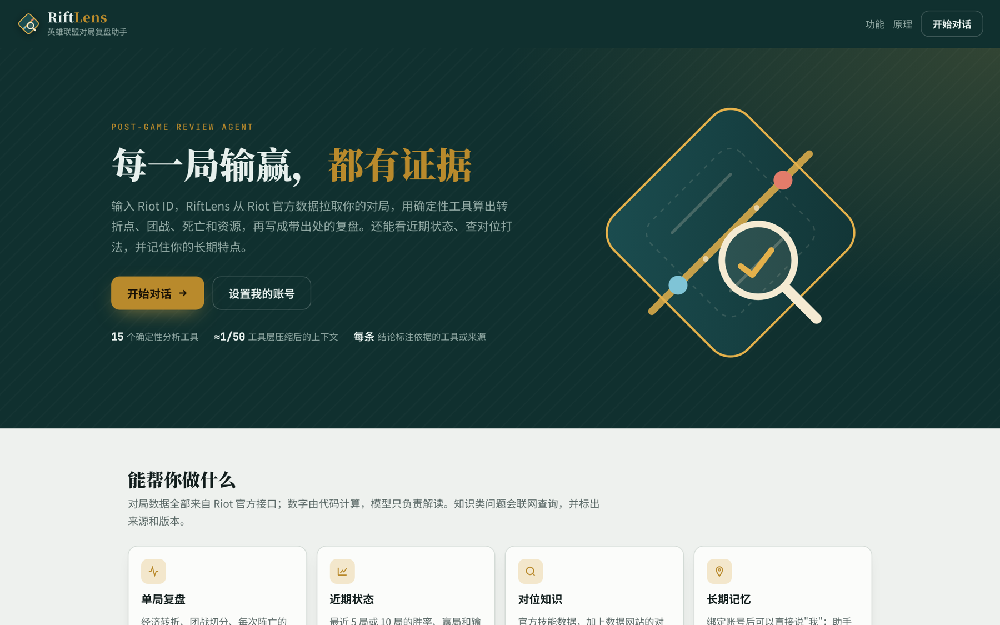
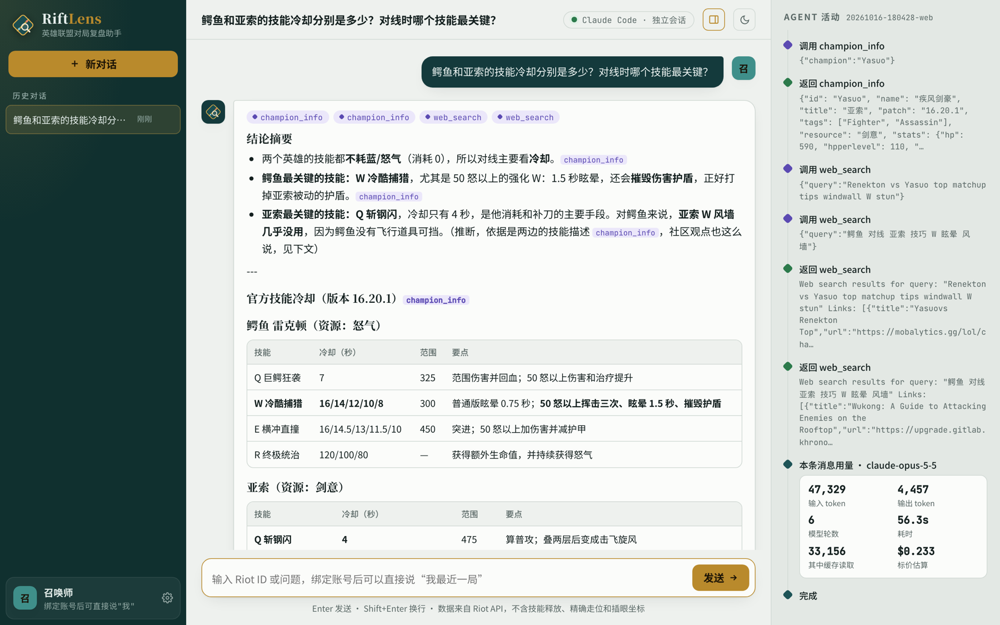
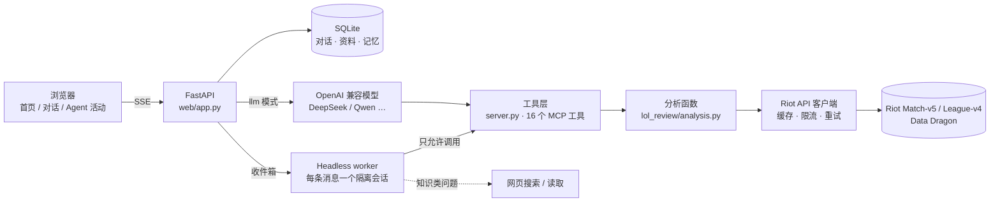

# RiftLens

**英雄联盟对局复盘 Agent：每一局输赢，都有证据。**

RiftLens 从 Riot 官方接口拉取对局数据，用确定性的分析工具算出事实（转折点、团战、阵亡、资源、对线），再由大模型写成**每条结论都标注依据**的复盘。它也能分析近期状态、回答对位问题，并记住用户的长期特点。

> 这是一个个人学习项目，重点不在"又一个数据网站"，而在于：**在没有标准答案的分析任务上，怎样让 agent 的结论可验证、少幻觉，并且能量化成本。**





---

## 功能

| 功能 | 说明 | 示例 |
|---|---|---|
| **单局复盘** | 经济转折、团战切分、每次阵亡的原因、资源争夺、对线期对比、规则检出的失误 | `复盘 Player#TAG 最近一局` |
| **近期状态** | 最近 N 局的胜率、赢局与输局对比、英雄池；只用终局统计，不拉时间线 | `我最近 10 局怎么样` |
| **对位知识** | Riot 官方英雄数据 + 联网查询数据网站和玩家讨论，标注版本、来源和分歧 | `亚索怎么打鳄鱼` |
| **长期记忆** | 用户资料（Riot ID、位置、段位、目标）+ agent 记下的长期特点，可查看、可删除 | `复盘我最近一局` |
| **段位基准** | 从同段位、同版本、同英雄的对局中采样，计算每分钟经济/经验/补刀分位数 | 李青打野 · 钻石 · 16.20 |
| **可观测** | 每一步工具调用、返回、记忆写入、token 用量和成本实时显示，并写入轨迹文件 | — |

---

## 架构



### 设计要点

1. **计算和解读分离。** 所有数字由确定性代码从 Riot 原始数据算出，模型不自己数数、不做算术。一局原始数据约 21.5 万 token，经工具层压缩后交给模型的约 4 千 token。
2. **结论必须有依据。** 每条结论标注来源工具（例如 `[jungle_stats]`）或网页链接；数据里没有的信息（技能释放、精确走位、插眼坐标）要明确说"无法判断"。
3. **轨迹可追溯。** 每次 API 请求、工具调用、决策都写进 `traces/*.jsonl`，可以从结论追到原始工具输出。
4. **隔离的执行环境。** 每条用户消息由一个全新的 headless 会话处理：不带任何开发对话历史，系统提示词完全替换，只允许调用项目工具和网页搜索。因此能精确统计单次问答的 token 与成本。
5. **记忆只记用户本人。** 分析别人的账号时不写入长期记忆；注入时提示"记忆可能过时，以新数据为准"。

### 三种运行模式

| 模式 | 谁来当模型 | 适合 |
|---|---|---|
| `bridge`（默认） | 本机 Claude Code，以 headless 方式运行，每条消息一个隔离会话 | 个人使用、开发调试 |
| `llm` | 任意 OpenAI 兼容接口（DeepSeek、通义千问等），自带工具调用循环 | 部署、多人使用、跨模型评估 |
| `b0` | 不用模型，固定骨架 + 模板 | 评估时的 baseline |

---

## 快速开始

### 1. 安装

```bash
git clone <this-repo> && cd lol-review-agent
python3 -m venv .venv
.venv/bin/pip install -r requirements.txt
cp .env.example .env    # 可选：填入 Riot API key
```

需要 Python 3.11+。

**Riot API key 是可选的。** 不配置也能启动，对位知识问答（官方英雄数据 + 网页搜索）可以直接用；查询对局时才需要 key。两种配置方式：

- 写进 `.env` 的 `RIOT_API_KEY`；
- 或者在网页左下角的**设置**里填写：会先向 Riot 验证，再保存到本机的 `data/riot_api_key`（已被 git 忽略）。

开发者 key 在 [developer.riotgames.com](https://developer.riotgames.com) 免费申请，**每 24 小时过期**。

### 2. 启动网页

```bash
.venv/bin/python -m uvicorn web.app:app --host 127.0.0.1 --port 8765
```

打开 <http://127.0.0.1:8765>。

### 3. 启动模型端（按模式选一种）

```bash
# bridge 模式：需要本机已安装并登录 Claude Code
.venv/bin/python -m web.headless_worker              # 默认模型
.venv/bin/python -m web.headless_worker --model sonnet

# llm 模式：在 .env 中填写 LLM_BASE_URL / LLM_API_KEY / LLM_MODEL，无需 worker
```

### 4. 其他用法

```bash
# 在 Claude Code 中作为 MCP 工具使用
claude mcp add lol-review -- "$PWD/.venv/bin/python" "$PWD/server.py"

# 命令行：跑固定骨架并输出全部工具结果和轨迹
.venv/bin/python review.py "Player#TAG"

# 构建段位基准（例：钻石 · 16.20 · 李青打野 · 40 局）
.venv/bin/python -m lol_review.benchmark LeeSin JUNGLE DIAMOND 16.20 --n 40

# 运行一个隔离的实例（独立的数据库、轨迹和收件箱，例如用于演示）
RIFTLENS_STATE_DIR=/tmp/riftlens-demo .venv/bin/python -m uvicorn web.app:app --port 8766
RIFTLENS_STATE_DIR=/tmp/riftlens-demo .venv/bin/python -m web.headless_worker

# 轨迹 / 基准可视化
.venv/bin/python trace_view.py traces/<run_id>.jsonl
.venv/bin/python benchmark_view.py benchmarks/LeeSin_JUNGLE_DIAMOND_16.20.json <match_id> "<Riot ID>"
```

---

## 工具列表

| 类别 | 工具 | 作用 |
|---|---|---|
| 数据获取 | `find_player` | Riot ID → puuid、段位 |
| | `list_recent_matches` | 最近对局列表 |
| | `get_match_summary` | 10 名玩家的终局统计 |
| 全局分析 | `gold_xp_curve` | 每分钟经济差、经验差 |
| | `turning_points` | 经济波动最大的时段及其中的击杀和资源 |
| | `segment_fights` | 把击杀聚合成团战 |
| | `objective_control` | 龙、先锋、男爵、塔、水晶的归属 |
| 个人分析 | `analyze_deaths` | 每次阵亡：击杀者、敌方人数、是否在对方半场、附近队友、随后丢掉的资源 |
| | `lane_phase_stats` | 10 / 15 分钟与对位的差距 |
| | `item_timeline` | 成装时间 |
| | `jungle_stats` | 打野视角：参团、资源争夺、反野、前 10 分钟路线 |
| | `detect_mistakes` | 规则检出的失误 |
| | `kill_log` | 每次击杀的击杀者、被击杀者、助攻，用于核对"单杀"等说法 |
| 多局 | `recent_form` | 最近 N 局趋势，只用终局统计 |
| 知识 | `champion_info` | 官方英雄数据（中文，当前版本），支持"鳄鱼""瞎子"等外号 |
| 规划 | `update_plan` | 记录和更新复盘计划 |

---

## 数据来源与局限

**数据来源**
- Riot Match-v5（对局详情、逐分钟时间线）、League-v4（段位）、Account-v1。
- [Data Dragon](https://developer.riotgames.com/docs/lol#data-dragon)：官方静态数据，包括英雄、装备。
- 知识类问题按需进行网页搜索，不批量抓取任何网站。

**已知局限**
- 时间线里的位置只有**每分钟一次**快照；**插眼事件没有坐标**；**没有技能释放数据**。所以团战走位、视野布置、技能使用都判断不了。
- Riot API **不提供历史 LP**，只能记录从开始追踪之后的段位变化。
- 对局数据实测可回溯约 17 个月；Riot 官方的保留上限约 2 年，尚未实测验证。
- 大区目前固定为配置中的服务器，自动识别大区还没有做。
- `turning_points` 用"经济差变化最大的时段"代替胜率模型，属于代理指标。
- 规则检测存在误报，例如 2 换 1 的阵亡也会被算作"孤身深入"。

---

## 评估

### 目前已有的结果（试点，样本很小）

| 实验 | 结果 | 说明 |
|---|---|---|
| 工具层的上下文压缩 | 约 21.5 万 → 约 4.2 千 token（约 1/50） | 1 局，基于轨迹统计 |
| Baseline：模型直接读原始 JSON | 约 45 条陈述中 5 条错误，包括编造技能释放、团战结论说反；子 agent 消耗约 55 万 token | **1 局，人工核对**，仅作方向性参考 |
| 单次问答的真实成本（隔离会话） | 近期状态约 2.5 万输入 / 3 千输出 token；联网知识问答约 9.8 万 / 5.3 千 | 3 次实测 |
| 段位基准采样 | 扫描 1,017 场钻石对局，得到 40 场 16.20 李青打野 | — |

### 计划中的正式评估

- **事实核对器：** 结构化结论 + **独立于分析工具**的代码核对，判定为支持 / 矛盾 / 无法验证。
- **指标：** 事实准确率、矛盾率、无出处陈述率、关键发现 F1、拒答正确率、单次成本与延迟。
- **对比：** B0（无模型）、B1（直接读原始数据）、工具层、工具层 + 证据、工具层 + 核对修正；以及 Claude 和 DeepSeek 的跨模型对比。
- **数据集：** 50 局分层抽样 + 20 局专家标注 + 扰动对局 + 无法回答的问题。

---

## 项目结构

```
lol_review/
  riot.py           Riot API 客户端：路由、缓存、限流、重试、Data Dragon
  analysis.py       确定性分析函数（不调用模型）
  benchmark.py      段位基准采样
  trace.py          轨迹记录
server.py           MCP server：16 个工具
review.py           命令行：固定骨架复盘
web/
  app.py            FastAPI：对话、资料、记忆、SSE 流式输出、三种模式
  store.py          SQLite：对话、消息、用户资料、长期记忆
  bridge.py         网页与模型端之间的收件箱 + 工具调用命令行
  headless_worker.py  每条消息一个隔离的 Claude Code 会话，记录 token 与成本
  static/index.html   前端：首页、对话列表、聊天、Agent 活动时间轴、资料与设置面板
docs/screenshots/   README 截图
trace_view.py       轨迹 → 网页
benchmark_view.py   基准对比 → 网页
```

---

## 路线图

- [ ] 事实核对器 + 50 局评估集 + 对比实验
- [ ] 接入 DeepSeek，做跨模型准确率与成本对比
- [ ] 自动识别大区；按队列和位置拆分 `recent_form`
- [ ] 规则修正：阵亡前刚完成击杀的交换不计为失误
- [ ] LP 追踪：定时记录段位快照，生成真实 LP 曲线
- [ ] 胜率模型替代经济差代理，用于转折点和表现分
- [ ] 版本公告 / Wiki 机制的 RAG 知识库
- [ ] Skill 库：agent 提议新的分析能力，通过评估闸门后才写入
- [ ] 单元测试与 CI

---

## 声明

RiftLens 是个人学习项目，未获得 Riot Games 的认可，不代表 Riot Games 或任何参与《英雄联盟》制作与管理的官方人员的观点或意见。Riot Games 和《英雄联盟》是 Riot Games, Inc. 的商标或注册商标。使用本项目需遵守 [Riot Developer Policies](https://developer.riotgames.com/policies/general)。

开发过程使用了 Claude Code 辅助编码。

## License

[MIT](LICENSE)
